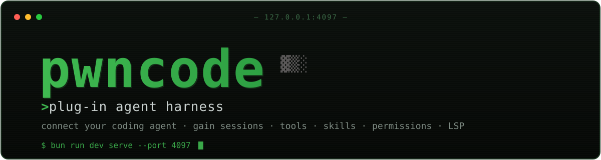
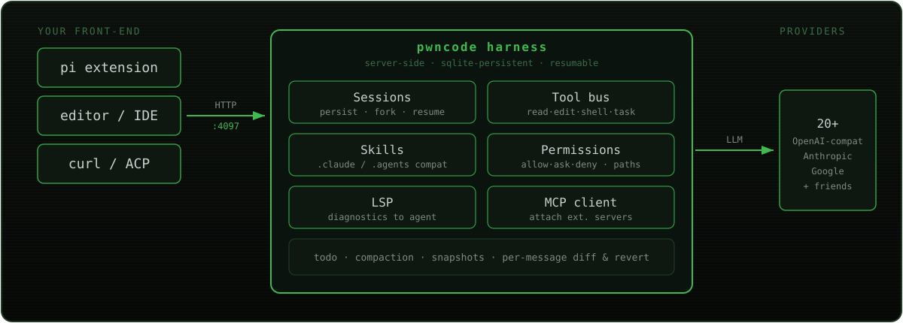

<div align="center">



<br>

**Run it as a local service. Connect your existing coding agent. Your agent gains the machinery it usually lacks.**

[](LICENSE)
[](https://bun.sh)
[](../../actions)
[](#what-the-harness-provides)
[](https://github.com/anomalyco/opencode)

</div>

---

## What is it

**pwncode is not a new coding agent.** pi, an editor extension, or a plain `curl`
stay the front-end. pwncode is the machinery underneath — persistent server-side
sessions, a full tool bus, skills, permissions, LSP — behind **one HTTP API**.

Any client that can make HTTP requests can drive it. Writing an adapter is ~300
lines; the pi bridge in `integrations/pi/` is the reference.

<div align="center">

</div>

## What the harness provides

| | |
|---|---|
| **🗂 Sessions** | Server-side, sqlite-persistent, resumable and forkable via API. Survive restarts, shared between clients. |
| **🧰 Tool bus** | read · edit · write · glob · grep · shell · task (subagents) · plan · question · skill · webfetch · websearch · screenshot |
| **🔌 20+ LLM providers** | OpenAI-compatible endpoints, Anthropic, Google, and friends. |
| **🧠 Skills** | Layered bundled/user/pack/project, installable from git/URL. Compatible with `.claude/skills` and `.agents/skills`. |
| **🛡 Permissions** | allow / ask / deny per tool and path, external-directory whitelists, doom-loop protection. |
| **🩺 LSP + MCP** | Language-server diagnostics surfaced to the agent; attach external MCP servers as a client. |

Plus **todo, compaction, snapshots** — per-message diff and revert.

## Connect pi

```bash
pi install ./integrations/pi/harness-bridge.ts
```

That's it — pi's model now calls the `harness` tool when a task should be
delegated (say it natively: «отрефактори это через harness»). One tool call
creates/continues a harness session and returns the result; `sessionID`
continues the same session with full context. See
[integrations/pi/README.md](integrations/pi/README.md).

## Connect anything else

The whole flow is two HTTP calls:

```bash
SID=$(curl -s -X POST localhost:4097/session -d '{}' -H 'content-type: application/json' | bun -e 'console.log((await Bun.stdin.json()).id)')
curl -s -X POST localhost:4097/session/$SID/prompt_async -d '{"parts":[{"type":"text","text":"the task"}]}' -H 'content-type: application/json'
# poll GET /session/$SID/message until the last assistant message has time.completed
```

API reference: `GET /doc`. ACP is also available (`acp` command).

## Quickstart

```bash
git clone <this-repo> && cd pwncode
bun install                                # needs bun >= 1.3
bun run dev serve --port 4097              # headless server on 127.0.0.1:4097
```

Point any OpenAI-compatible provider at it:

```bash
mkdir -p ~/.config/pwncode ~/.local/share/pwncode
cat > ~/.config/pwncode/pwncode.json <<'EOF'
{
  "model": "my-provider/my-model",
  "provider": {
    "my-provider": {
      "options": { "baseURL": "https://api.example.com/v1" },
      "models": { "my-model": { "name": "My Model" } }
    }
  }
}
EOF
echo '{"my-provider": {"type": "api", "key": "sk-..."}}' > ~/.local/share/pwncode/auth.json
chmod 600 ~/.local/share/pwncode/auth.json
```

Then verify:

```bash
./scripts/smoke.sh    # boots the server, runs one model turn, exits 0 on success
```

## Provenance & license

MIT. Extracted from [PentestCode](https://github.com/s0ld13rr/pentestcode)
(`63e379c`), a hard fork of [OpenCode](https://github.com/anomalyco/opencode)
(MIT), with the penetration-testing layer removed. Baseline commit `d14826a` is
the unmodified PentestCode source; commits after it are the extraction. A
`pentest` branch restores that layer (21 security tools, recon/exploiter/critic
agents, engagement state) as an optional flavor.

Upstream credit: OpenCode contributors (anomalyco/opencode) and PentestCode
contributors (s0ld13rr/pentestcode).
